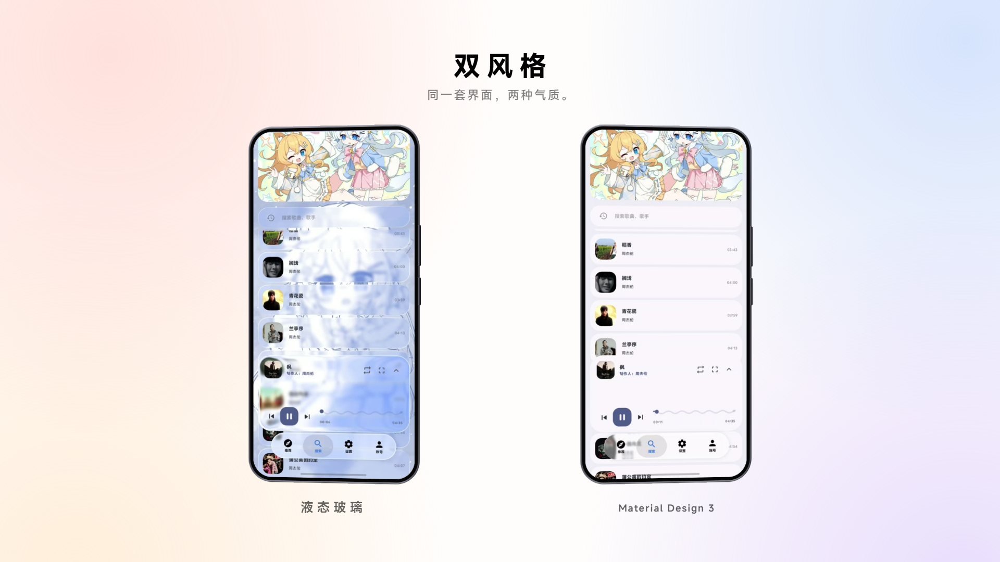
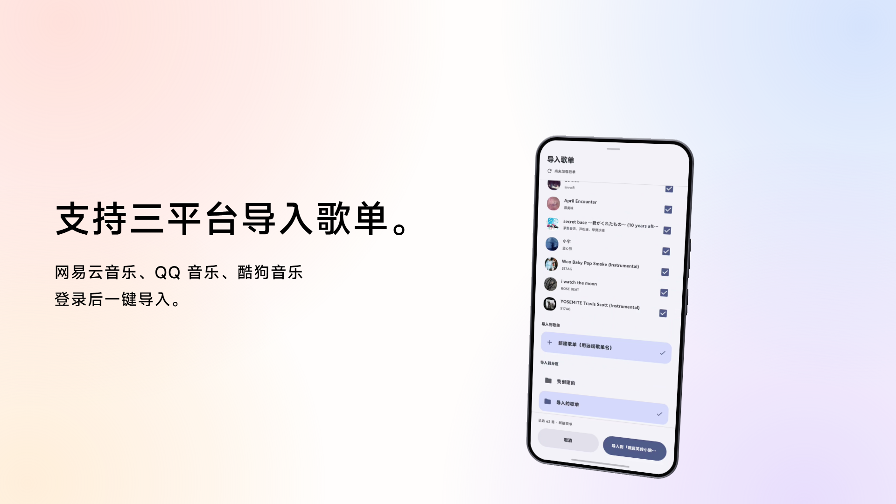
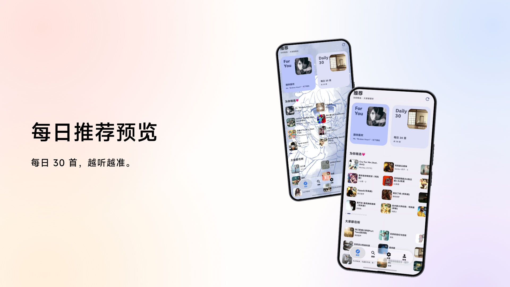

# MINova

一个 Android 音乐播放器：多平台音源聚合、歌单导入与云同步、歌词、个性化主题。

本项目以 **GNU GPL-3.0** 开源（完整条款见 [LICENSE](LICENSE)）。
>
> 项目内全部注释由 AI 生成，不足之处请见谅，详见 [必看.md](必看.md)。

## 功能

- **多平台音源聚合**：酷我 / 咪咕 / B站 / 网易云 / QQ音乐 / 酷狗
- **歌单导入**：从各音乐平台导入自己的歌单，按账号隔离
- **云端同步**：登录后歌单自动同步，卸载重装 / 换设备可恢复
- **歌词**：LRC 解析，支持逐字时间戳（卡拉OK式）与翻译行
- **播放器**：全屏播放页、迷你播放器、通知栏控制、MediaSession
- **下载到本地**：离线播放
- **双视觉风格**：液态玻璃（liquid glass）与 Material 3 一键切换
- **记住上次播放**：下次打开继续上次的歌与进度
- **账号**：注册 / 登录 / 收藏 / 播放历史 / 意见反馈

## 预览

## 协议

本项目以 **GNU GPL-3.0** 开源（完整条款见 [LICENSE](LICENSE)）。
